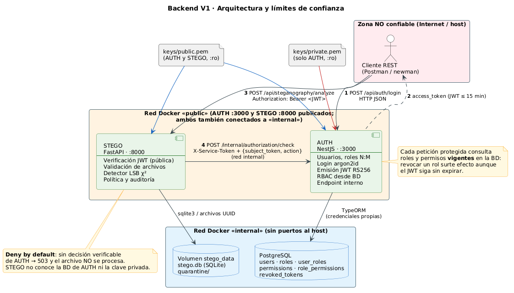
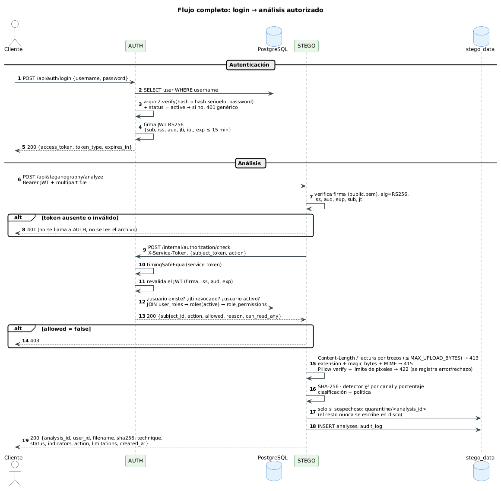
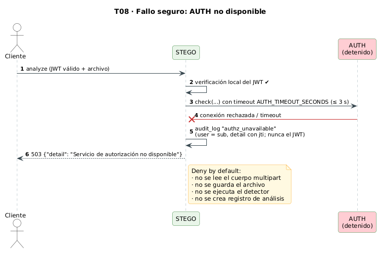
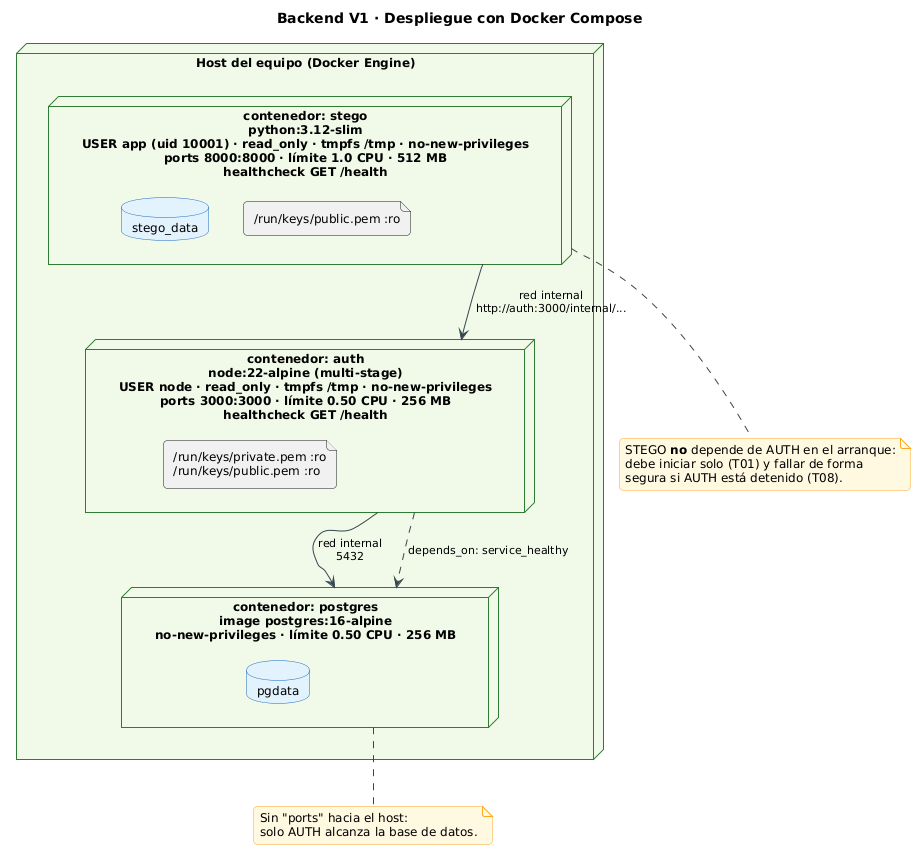

# 1. Arquitectura del Backend V1

> Fuente de los diagramas: `docs/diagrams/*.puml` (PlantUML). Las imágenes en `docs/diagrams/img/` se regeneran con `scripts/render-diagrams.sh`.

## 1.1 Visión general

El Backend V1 está formado por **dos microservicios REST independientes**, cada uno con su propio proceso, lenguaje, configuración, Dockerfile, contrato OpenAPI y almacenamiento:

| Servicio | Tecnología | Responsabilidad | Persistencia |
|---|---|---|---|
| **AUTH** | NestJS 12 · TypeScript · TypeORM | Identidades, roles (N:M), login, emisión de JWT RS256, decisiones RBAC vigentes, endpoint interno de autorización | PostgreSQL (exclusiva) |
| **STEGO** | Python 3.12 · FastAPI · Pillow · NumPy · SciPy | Validación de imágenes, detección LSB por chi-cuadrado, política de cuarentena y auditoría | SQLite + volumen propio |

La elección de **dos tecnologías distintas** es deliberada: hace imposible que la separación sea solo de carpetas y aprovecha el ecosistema científico de Python (NumPy/SciPy/Pillow) para el análisis estadístico, mientras AUTH reutiliza el stack trabajado en clase.



## 1.2 Límites de confianza

| Zona | Componentes | Nivel de confianza | Controles en el límite |
|---|---|---|---|
| Externa (host / Internet) | Cliente REST | **Ninguno** | Todo dato entrante se valida; JWT obligatorio; rate limit en login |
| Red Docker `public` | AUTH, STEGO | Servicios propios, pero **no se confían mutuamente** | STEGO se autentica ante AUTH con `X-Service-Token`; AUTH revalida el JWT del usuario |
| Red Docker `internal` | PostgreSQL, volumen de STEGO | Datos | Sin puertos al host; cada servicio solo alcanza su almacenamiento |
| Material criptográfico | `private.pem`, `public.pem` | Secreto / público | Montados `:ro`; la privada solo en AUTH |

Principios **Zero Trust** aplicados (NIST SP 800-207): ninguna petición se considera confiable por su origen de red; cada operación protegida exige una decisión de autorización explícita, actual y verificable; ante la duda, se deniega.

## 1.3 Flujo de una operación protegida



1. El cliente se autentica en AUTH y recibe un JWT RS256 de vida corta.
2. El cliente envía el JWT como `Authorization: Bearer` a STEGO.
3. STEGO verifica **localmente** firma, algoritmo, `iss`, `aud` y `exp` con la clave pública. Si falla → 401 sin contactar a AUTH.
4. STEGO pide a AUTH una **decisión vigente** (`/internal/authorization/check`). AUTH revalida el token, la revocación por `jti`, el estado del usuario y sus roles y permisos actuales en la BD.
5. Solo con `allowed = true` STEGO lee y valida el archivo, ejecuta el detector y persiste el resultado.

## 1.4 Fallo seguro



Si AUTH no responde en el tiempo configurado, responde con un código inesperado o con un cuerpo no verificable, STEGO responde **503** y no lee el cuerpo, no guarda el archivo ni ejecuta el detector.

## 1.5 Despliegue



| Contenedor | Imagen base | Límite CPU | Límite memoria | Endurecimiento |
|---|---|---|---|---|
| postgres | postgres:16-alpine | 0.50 | 256 MB | sin puertos al host, solo red `internal`, volumen `pgdata`, `no-new-privileges` |
| auth | node:22-alpine (multi-stage) | 0.50 | 256 MB | `USER node`, `read_only`, `tmpfs /tmp`, `no-new-privileges` |
| stego | python:3.12-slim | 1.00 | 512 MB | `USER app` (no-root), `read_only`, `tmpfs /tmp`, `no-new-privileges`, volumen `stego_data` |

Los límites cumplen dos funciones: optimizan recursos y **mitigan la denegación de servicio** por imágenes diseñadas para agotar memoria (decompression bombs).

Verificado contra el `docker-compose.yml` real con `docker inspect` (límites efectivos, `ReadonlyRootfs`, usuario y `SecurityOpt`). Consumo en reposo medido con `docker stats --no-stream` el 2026-11-04 ([evidencia](evidencias/docker-stats.txt)):

| Contenedor | Memoria usada / límite | % |
|---|---|---|
| auth | 51.96 MiB / 256 MiB | 20.30 % |
| postgres | 13.41 MiB / 256 MiB | 5.24 % |
| stego | 92.84 MiB / 512 MiB | 18.13 % |

## 1.6 Independencia demostrable (T01)

```bash
docker compose up -d postgres auth   # AUTH funciona sin STEGO
curl -s localhost:3000/health
docker compose up -d stego           # STEGO arranca aunque AUTH se detenga
docker compose stop auth
curl -s localhost:8000/health        # STEGO sigue vivo; sus operaciones protegidas dan 503
docker compose start auth
```

Ejecutado el 2026-11-04 con `./scripts/evidencia-t01-t08.sh` ([salida completa](evidencias/t01-t08.txt)): con STEGO detenido, `GET :3000/health` → 200 y `:8000` sin respuesta; con AUTH detenido, `GET :8000/health` → 200 y `:3000` sin respuesta. Tras `start`, ambos vuelven a `healthy` sin tocar al otro.
