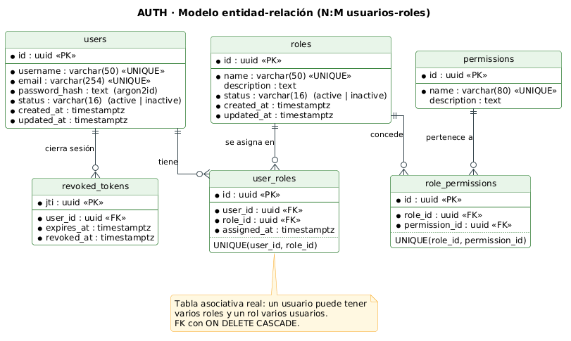

# 2. Modelo de datos de identidad (AUTH)



## 2.1 Relación muchos a muchos

La asociación usuario–rol se implementa con la **tabla asociativa real** `user_roles`, con claves foráneas hacia `users` y `roles` y la restricción `UNIQUE(user_id, role_id)` definida **en la base de datos** mediante migración (no solo en el ORM). Por ello:

- un usuario puede tener varios roles (p. ej. `ana` → ANALYST + USER);
- un rol puede asignarse a varios usuarios (p. ej. ANALYST → `ana`, `beto`);
- repetir una asignación es rechazado por PostgreSQL (`23505 unique_violation`) y la API responde **409** (T06).

## 2.2 Entidades

| Tabla | Columnas | Restricciones |
|---|---|---|
| `users` | id, username, email, password_hash, status, created_at, updated_at | PK uuid; `username` y `email` UNIQUE; `password_hash` argon2id, nunca se expone |
| `roles` | id, name, description, status, created_at, updated_at | PK uuid; `name` UNIQUE |
| `user_roles` | id, user_id, role_id, assigned_at | PK uuid; FK → users, roles (ON DELETE CASCADE); UNIQUE(user_id, role_id) |
| `permissions` | id, name, description | PK uuid; `name` UNIQUE |
| `role_permissions` | id, role_id, permission_id | FK → roles, permissions; UNIQUE(role_id, permission_id) |
| `revoked_tokens` | jti, user_id, expires_at, revoked_at | PK jti; se consulta en cada petición autenticada |

**Por qué existen `permissions` y `role_permissions`:** el enunciado prohíbe listas de permisos codificadas en el programa. Los permisos de cada rol se cargan por *seed* en tablas, de modo que el código solo pregunta "¿tiene este usuario el permiso X?" y la respuesta sale de la BD.

## 2.3 Migraciones y seed

- `synchronize: false`: el esquema solo cambia mediante migraciones versionadas.
- El seed es idempotente: crea los roles ADMIN, ANALYST y USER, los permisos de la matriz (ver [seguridad](03-seguridad-jwt-rbac.md)) y el administrador inicial a partir de variables de entorno.

- Migración: `auth-service/src/database/migrations/1793836800000-InitIdentitySchema.ts` (SQL explícito: PK uuid con `gen_random_uuid()`, `UNIQUE`, `CHECK status IN ('active','inactive')` y FK `ON DELETE CASCADE`). Se aplica con `docker compose exec auth npm run migration:run`.
- Seed: `auth-service/src/database/seeds/seed.ts` (datos en `seed-data.ts`), ejecutado con `docker compose exec auth npm run seed`. Usa `INSERT … ON CONFLICT DO NOTHING`, así que re-ejecutarlo no duplica filas ni cambia el hash del admin.
- Resultado tras el seed: ADMIN con 7 permisos, ANALYST con 3, USER con 1; `admin` asignado a ADMIN.
- Estructura real de `user_roles` (`\d user_roles`): [evidencias/user_roles-schema.txt](evidencias/user_roles-schema.txt) — muestra `uq_user_roles_user_role UNIQUE CONSTRAINT (user_id, role_id)` y las dos FK con `ON DELETE CASCADE`.
- Pruebas: `auth-service/test/database.e2e-spec.ts` (11 casos contra Postgres real: tablas, 23505 por duplicado, N:M, CASCADE, FK, CHECK, matriz §5, argon2id, idempotencia, `password_hash` no seleccionado).

## 2.4 Evidencia N:M (T05, T06)

Resultado real de `GET /api/users` (token de admin) tras ejecutar la colección completa (I2, 2026-11-04), filtrado a los usuarios demo. La respuesta no incluye `password_hash`:

```json
[
  {"id":"53abf0d9-8c0d-40a8-81ca-85dbfcd07c65","username":"ana","email":"ana@demo.local","status":"active",
   "created_at":"2026-11-04T07:33:00.029Z","updated_at":"2026-11-04T07:33:00.029Z",
   "roles":[{"assignment_id":"888ab7f0-f9b5-48d9-9624-5bf58359094b","role_id":"0f6e8ae6-f325-4540-acf9-89c4d0c2768b","name":"ANALYST"},
            {"assignment_id":"a659037e-b5eb-4c81-a21f-25d0197fe85d","role_id":"91e2821f-32a0-42b7-aa64-d9a06526b463","name":"USER"}]},
  {"id":"261082f2-8a64-43e5-a597-2afb4428feb6","username":"beto","email":"beto@demo.local","status":"active",
   "created_at":"2026-11-04T07:33:00.840Z","updated_at":"2026-11-04T07:33:00.840Z",
   "roles":[{"assignment_id":"0d3355ae-ea62-4a24-8feb-0b08f87ab326","role_id":"0f6e8ae6-f325-4540-acf9-89c4d0c2768b","name":"ANALYST"}]},
  {"id":"7c4c5906-7383-4833-8b4c-de55d0c861de","username":"carla","email":"carla@demo.local","status":"active",
   "created_at":"2026-11-04T07:33:01.731Z","updated_at":"2026-11-04T07:33:01.731Z",
   "roles":[{"assignment_id":"ac61de22-a11a-41cc-ae1c-57d0fa099b16","role_id":"91e2821f-32a0-42b7-aa64-d9a06526b463","name":"USER"}]}
]
```

- **Un usuario con dos roles:** `ana` tiene ANALYST y USER.
- **Un rol en dos usuarios:** ANALYST (`role_id 0f6e8ae6-…`) está en `ana` y `beto`; USER (`91e2821f-…`) en `ana` y `carla`.
- **Sin duplicados (T06):** al repetir `POST /api/user-roles` con `ana`+ANALYST la API devolvió 409 y la lista conserva una sola asignación (newman, carpeta T06).
- La asignación de `beto` tiene un `assignment_id` nuevo porque T07 retira su rol ANALYST y la colección lo restaura al final.
