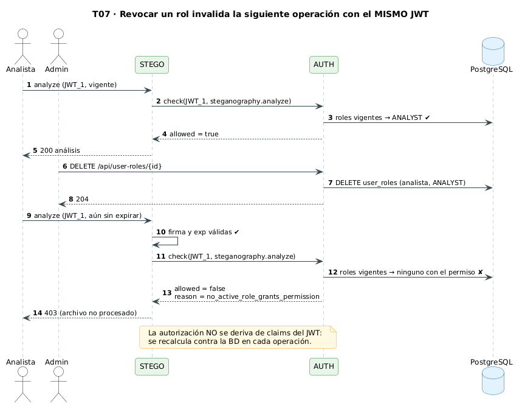
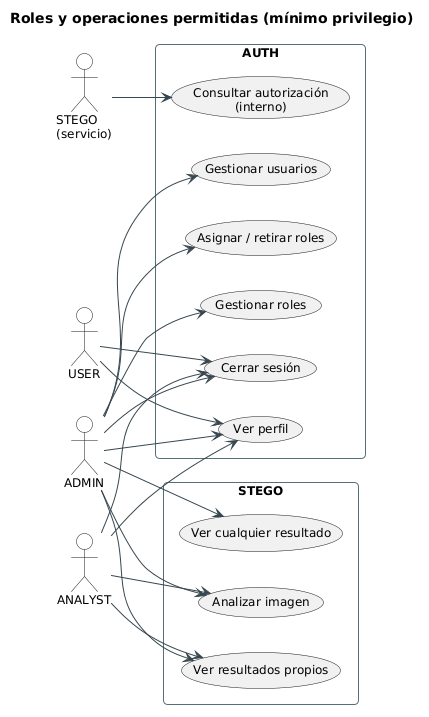

# 3. Autenticación JWT y autorización RBAC

## 3.1 Credenciales

- Contraseñas almacenadas con **argon2id** (librería `argon2`), con sal aleatoria por hash. Nunca se devuelven ni se registran.
- Política mínima: 12 caracteres.
- El login responde el mismo mensaje genérico (401) si el usuario no existe, está inactivo o la contraseña es incorrecta, y verifica contra un hash ficticio cuando el usuario no existe para no filtrar información por tiempo de respuesta.
- `LoginRateLimitGuard` (propio, en memoria) limita el login a 10 intentos por minuto y por IP (429 al excederlo). Sustituye a `@nestjs/throttler`, cuyo build CommonJS no carga `@nestjs/common` 12 (solo ESM) en los tests con Jest.

## 3.2 JSON Web Token

| Aspecto | Decisión | Motivo (RFC 7519 / RFC 8725) |
|---|---|---|
| Algoritmo | **RS256** fijo; se rechazan `none` y `HS*` | Evita confusión de algoritmo; permite verificar sin compartir secreto |
| Claves | RSA 2048 generadas con `scripts/gen-keys.sh`; privada solo en AUTH; pública en AUTH y STEGO; montadas `:ro`; fuera de git | Mínimo privilegio sobre material criptográfico |
| Claims | `sub` (id de usuario), `iss`, `aud`, `jti`, `iat`, `exp` | Identidad, emisor, destinatario, revocación, vigencia |
| Vigencia | `exp` ≤ 15 min (`JWT_TTL_SECONDS`) | Reduce la ventana de uso de un token filtrado |
| Verificación | firma + `alg` + `iss` + `aud` + `exp` en AUTH y en STEGO | Defensa en profundidad |
| Roles en el token | **No** se usan para autorizar | Un JWT antiguo no debe conservar privilegios revocados |
| Logout | el `jti` se inserta en `revoked_tokens` hasta su expiración | Revocación explícita de sesión |
| Registro | solo `jti` o los últimos 6 caracteres del token | Evita fuga de credenciales en logs |

## 3.3 RBAC con datos vigentes

Cada petición protegida (en AUTH mediante `PermissionsGuard`, y en STEGO a través de `/internal/authorization/check`) ejecuta una única consulta parametrizada (`AuthorizationService.can` en `auth-service/src/auth/authorization.service.ts`):

```sql
SELECT 1
FROM users u
JOIN user_roles ur       ON ur.user_id = u.id
JOIN roles r             ON r.id = ur.role_id AND r.status = 'active'
JOIN role_permissions rp ON rp.role_id = r.id
JOIN permissions p       ON p.id = rp.permission_id
WHERE u.id = $1 AND u.status = 'active' AND p.name = $2   -- $1 = sub del JWT, $2 = permiso
LIMIT 1;
```

No hay caché de decisiones: retirar una asignación, desactivar un rol o desactivar al usuario **tiene efecto en la siguiente petición**, aunque el JWT siga sin expirar (T07).



En AUTH las rutas se protegen con `@UseGuards(JwtAuthGuard, PermissionsGuard)` + `@RequirePermission('<permiso>')`. `PermissionsGuard` es *deny by default*: sin `req.user` → 401; ruta sin `@RequirePermission` o permiso no concedido → 403 `{"statusCode":403,"message":"Permiso denegado"}` y evento `authz_denied` en el log. Solo usa el `sub` validado por `JwtAuthGuard`; nunca roles del JWT, cabeceras ni cuerpo.

## 3.4 Matriz de roles y permisos

| Permiso | Operaciones | ADMIN | ANALYST | USER |
|---|---|:-:|:-:|:-:|
| `profile.read` | GET /api/auth/profile, POST /api/auth/logout | ✓ | ✓ | ✓ |
| `users.manage` | POST, GET /api/users · PATCH /api/users/:id | ✓ | | |
| `roles.manage` | POST, GET /api/roles · PATCH /api/roles/:id | ✓ | | |
| `user_roles.manage` | POST /api/user-roles · DELETE /api/user-roles/:id | ✓ | | |
| `steganography.analyze` | POST /api/steganography/analyze | ✓ | ✓ | |
| `steganography.results.read_own` | GET /api/steganography/results/:id (propios) | ✓ | ✓ | |
| `steganography.results.read_any` | GET /api/steganography/results/:id (cualquiera) | ✓ | | |

Un usuario con varios roles obtiene la **unión** de sus permisos, pero cada endpoint exige únicamente el permiso que necesita (mínimo privilegio).



## 3.5 Autenticación entre servicios

- STEGO envía `X-Service-Token` (secreto aleatorio ≥ 32 bytes, definido en ambos `.env`).
- AUTH lo compara con `crypto.timingSafeEqual` (tiempo constante) y responde 401 si no coincide.
- La comunicación viaja por la red Docker interna. **Limitación reconocida:** no se usa TLS ni mTLS entre contenedores en esta versión; se registra como riesgo residual y mejora futura en la [matriz de riesgos](06-matriz-riesgos.md).

## 3.6 Códigos de respuesta

| Situación | Código |
|---|---|
| Token ausente, malformado, firma inválida, `alg` no permitido, expirado, `iss` o `aud` incorrectos, `jti` revocado | 401 |
| Autenticado pero sin el permiso requerido | 403 |
| Recurso ajeno sin `read_any` | 404 (no revela existencia) |
| Asignación duplicada | 409 |
| Archivo mayor que `MAX_UPLOAD_BYTES` | 413 |
| Formato distinto de PNG/BMP o firma que no coincide | 415 |
| Imagen corrupta o que excede `MAX_PIXELS` | 422 |
| Demasiados intentos de login | 429 |
| AUTH no disponible para decidir | 503 |
